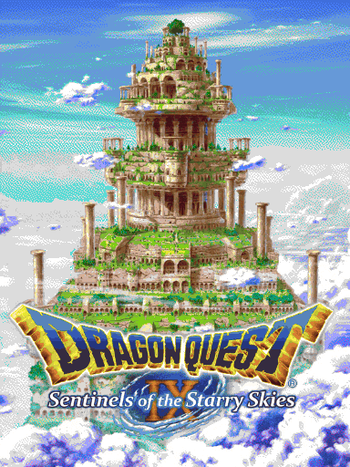
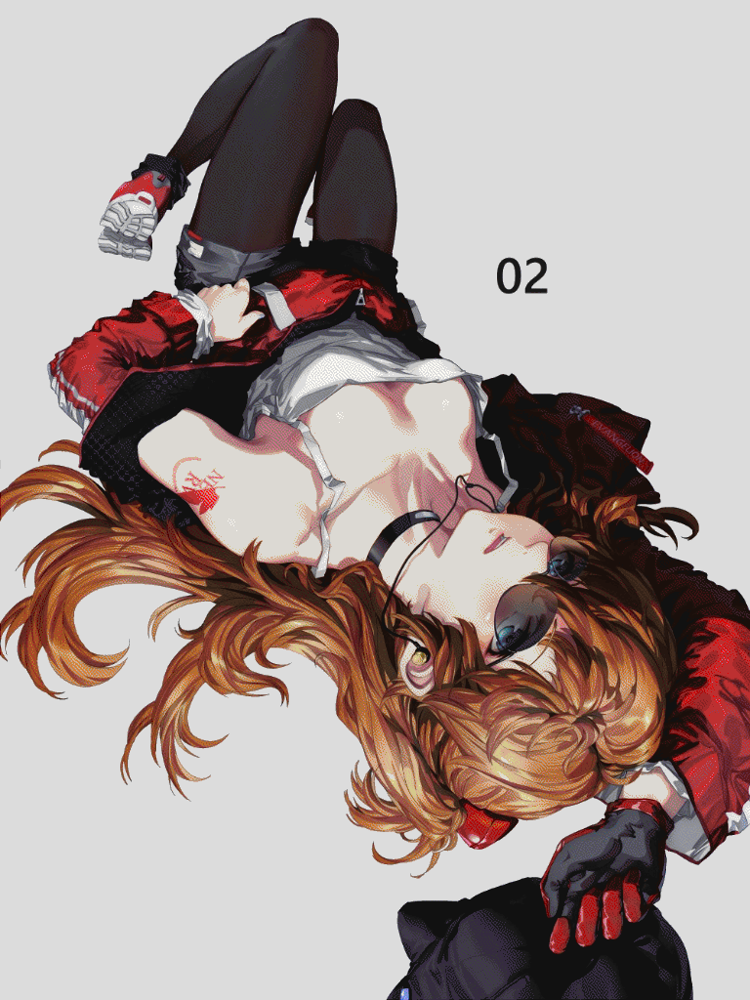
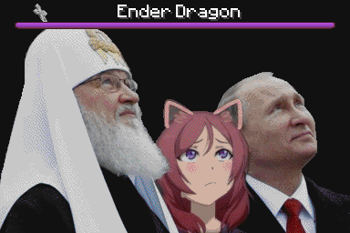
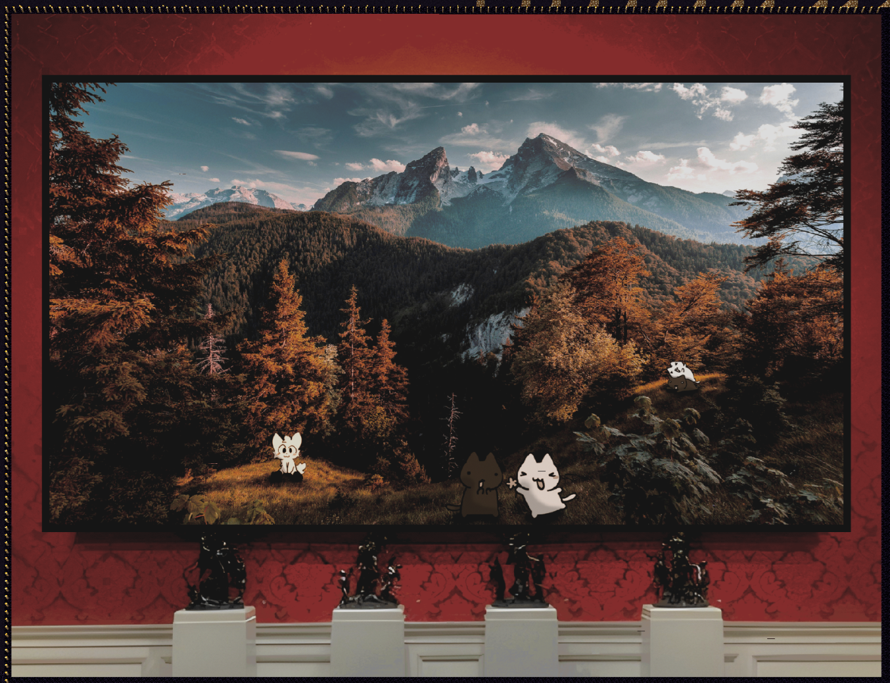
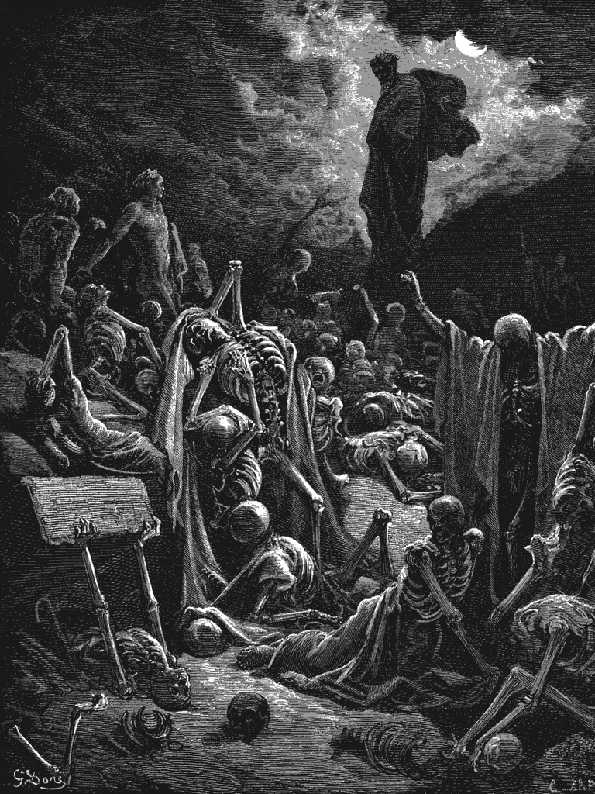
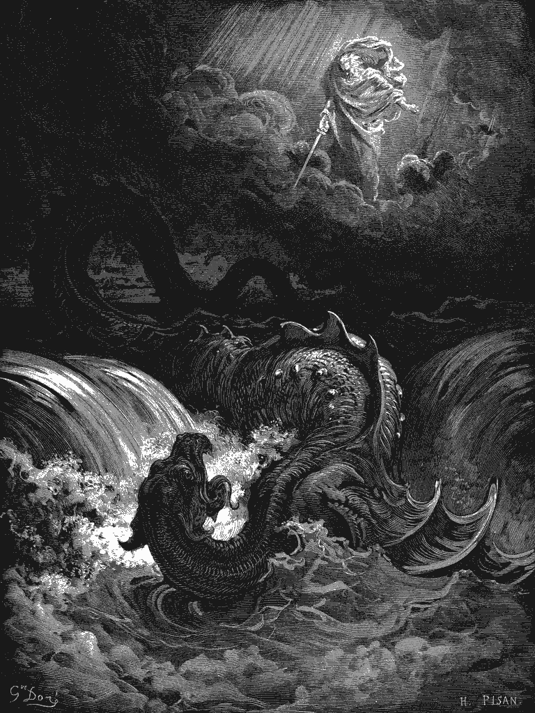

  <!-- Logo and Title -->
  
  <h1>Nerv Printer</h1>
  
Nerv Printer is an addon for the Meteor Client allowing you to build mapart from NBT files.
It works 100% autonomously and supports all block and staircasing variants.
Its main focus is reliability and compatibility with strict anti-cheat servers.

  <!-- Shields -->

  

## Initial Setup before use

Nerv Printer converts NBT files into printable mapart.
To convert an image to an NBT file you can use online tools like [MapartCraft](https://rebane2001.com/mapartcraft/).
The printer **can only handle 1x1 NBT files** so you have to click on "Download as 1x1 Split Zip" when generating the files.
Extract the files and paste them in a folder called "nerv-printer" in your ".minecraft" directory.
This folder is also created automatically when the printer is started for the first time.

Nerv Printer requires a map art platform that is aligned with the map chunks.
To detect map chunks, you can either use a map item or enable a printer module and interact with the ground.
An outline of the map chunk will then be rendered.
If you do not place your platform on a mushroom island, keep in mind you need to place light sources to prevent mob spawning.

You can find all mapart platform schematics [here](Documentation/Schematics).

## Workflow

All modules share the same core sequence for printing maps:

1. **Register Platform Components:**
On start-up, module will prompt you to interact with all components of the schematic.
The exact process depends on the module, but should be straightforward when following the instructions in chat.
When everything has been registered (and you are prompted to start the printer) you can use the "Save Config"-button to save the registered elements to a JSON file in the nerv-printer folder.
You can load it manually with the button or use the default-config-file setting to always load it on start-up.
Be careful to share the config as it contains the platform's coordinates.

2. **Start Print:**
After registration, interact with one of the configured start-blocks (button-blocks by default) to start printing.
All inventory slots that are empty or have mapart material will be marked for future use, so clear out your inventory first for maximal efficiency.
From here on out everything is fully automated.

3. **Build Map:**
The bot constructs the map line by line.
It actively calculates the maximum area it can cover using its available free inventory slots and restocks accordingly.
When a material runs out, it dumps unnecessary items into the DumpStation and repeats the cycle.

4. **Create Map Item:**
Upon completing the map, the bot retrieves an empty map and a glass pane from the MapMaterialChest.
It walks to the center of the area to fill the map, locks it at the Cartography Table, and deposits it in the FinishedMapChest.

5. **Clear Map Area:**
The area where the map was built is cleared so the next one can be placed.
This either happens automatically by flushing it with water or mining by the bots.
Optionally, finished NBT file will be moved to a "_finished_maps" folder after this step.
Finally, it proceeds placing the next NBT file or idles until there is a new file in the nerv-printer folder.

## Printer Modules

### Carpet (Flat) Printer
The Carpet Printer prints the map line-by-line and does not reuse carpet items, making it only suited for servers where carpet duping is enabled.
You can find the full documentation [here](Documentation/CarpetGuide.md).

### Suppression Printer
The Suppression printer uses 2-layer color suppression to build full color staircased maps while essentially building 2 flat maps and mining it again line-by-line.
The module requires 2-5 accounts to run.
Each bot is assigned to either the upper or lower layer.
The target layer will be mentioned in chat on start-up.
Move the bot to the layer before the print is started on the master account.
You can change the schematic however you like, however, the lower and upper layer bots share the material chests so they need to be accessible from both layers.

### Map Namer
Semi-automatically names unnamed map items in inventory. Pauses on anvil break and insufficient xp and can be resumed.

## Using Multiple Accounts

Nerv Printer allows users to let multiple bots work together on the same platform.
There is always one master bot which coordinates the slave bots.
**All bots need to be configured to use the same nerv-printer folder.**
If you use a launcher that creates a new Minecraft folder per instance, **you need to use the "custom-folder-path" setting** to configure the nerv-printer folder.
Load the configuration and enable the module on the master account, then on all slave accounts.
To start printing, press the start-button on the master account.

## Verified on Servers
- Contantiam (Folia with Grim anti-cheat)
- 2b2t
- 6b6t
- 8b8t
- 9b9t
- EndCrystal
- MineTexas
- 2B2FR
- FBFT

## Mapart Gallery
A collection of maps printed with this addon:

  
  
  
  
  
  
  
  
  
  
  
  
  
  
  
  
  
  
  
  

